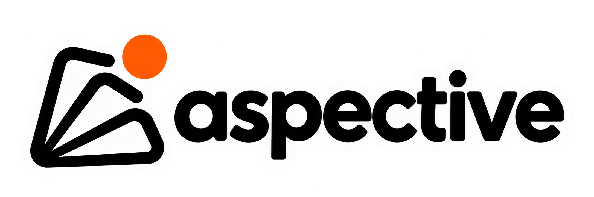

<h1 align="center">
  <a href="https://oliverhennhoefer.github.io/aspective/">
    
  </a>
</h1>

<p align="center">
  <strong>Peer-reviewed variants of classic estimators that never made it into scikit-learn,<br>
  with the scikit-learn API and a public benchmark gate.</strong>
</p>

<p align="center">
  <a href="https://github.com/OliverHennhoefer/aspective/actions/workflows/tests.yml"></a>
  <a href="https://codecov.io/gh/OliverHennhoefer/aspective"></a>
  <a href="https://oliverhennhoefer.github.io/aspective/"></a>
  <a href="https://github.com/OliverHennhoefer/aspective/blob/main/bench/RESULTS.md"></a>
  <a href="https://github.com/OliverHennhoefer/aspective/blob/main/pyproject.toml"></a>
  <a href="https://github.com/OliverHennhoefer/aspective/blob/main/LICENSE"></a>
</p>

<p align="center">
  <a href="https://oliverhennhoefer.github.io/aspective/"><b>Documentation</b></a> ·
  <a href="https://oliverhennhoefer.github.io/aspective/quickstart/">Quickstart</a> ·
  <a href="https://oliverhennhoefer.github.io/aspective/user_guide/choosing/">Choosing an estimator</a> ·
  <a href="https://oliverhennhoefer.github.io/aspective/api/">API reference</a> ·
  <a href="bench/RESULTS.md">Benchmark results</a> ·
  <a href="CHANGELOG.md">Changelog</a>
</p>

Naive Bayes, LDA, k-NN, CART, random forests, AdaBoost, the lasso, logistic
regression and Isolation Forest are the workhorses of applied machine
learning. The literature has published variants of each that fix a known
weakness and compared them carefully with the original, but most never
reached a mainstream Python library. aspective collects them.

## Why aspective?

- **From the literature.** Every estimator comes from a paper in a strong
  venue that compared it with its vanilla version in a principled way. Its
  docstring cites that paper and says when to prefer it.
- **Benchmark-gated.** On dozens of public datasets, every estimator is
  statistically non-inferior to the vanilla model it improves on
  ([protocol](bench/README.md), [results](bench/RESULTS.md)). Candidates that
  fail the gate are removed, and the benchmark README says which.
- **Drop-in.** Supervised estimators pass scikit-learn's `check_estimator`,
  so pipelines, grid search and cross-validation just work. Anomaly
  detectors follow PyOD's `BaseDetector` contract.

## Installation

```bash
pip install aspective          # classifiers and regressors
pip install "aspective[pyod]"  # detectors then subclass PyOD's BaseDetector
```

The anomaly detectors work without PyOD through a small stand-in base class
with the same contract. With PyOD installed they are genuine PyOD detectors
and work inside PyOD's ensembles (LSCP, SUOD), thresholding and benchmarks.

## Quickstart

```python
from sklearn.datasets import load_wine
from sklearn.model_selection import GridSearchCV
from aspective.discriminant_analysis import RegularizedDiscriminantAnalysis

X, y = load_wine(return_X_y=True)
search = GridSearchCV(
    RegularizedDiscriminantAnalysis(),
    {"lam": [0, 0.25, 0.5, 0.75, 1], "gamma": [0, 0.1, 0.5]},
).fit(X, y)
```

```python
from aspective.anomaly import RSHashDetector

detector = RSHashDetector(contamination=0.05, random_state=0).fit(X)
detector.decision_scores_  # higher means more anomalous
detector.predict(X)  # 0 inlier, 1 outlier, as in PyOD
```

## Estimators

Start from the model you already use; the
[guide](https://oliverhennhoefer.github.io/aspective/user_guide/choosing/)
says which variant helps when.

| Estimator | Improves on | Paper |
|---|---|---|
| `discriminant_analysis.RegularizedDiscriminantAnalysis` | LDA, QDA | Friedman, JASA 1989 |
| `discriminant_analysis.MixtureDiscriminantAnalysis` | LDA | Hastie & Tibshirani, JRSS-B 1996 |
| `naive_bayes.AODEClassifier` | Naive Bayes | Webb, Boughton & Wang, Machine Learning 2005 |
| `naive_bayes.A2DEClassifier` | Naive Bayes | Webb, Boughton, Zheng, Ting & Salem, Machine Learning 2012 |
| `naive_bayes.TANClassifier` | Naive Bayes | Friedman, Geiger & Goldszmidt, Machine Learning 1997 |
| `naive_bayes.KDBClassifier` | Naive Bayes | Sahami, KDD 1996 |
| `naive_bayes.HiddenNaiveBayesClassifier` | Naive Bayes | Zhang, Jiang & Su, AAAI 2005 |
| `naive_bayes.FlexibleNaiveBayes` | Gaussian naive Bayes | John & Langley, UAI 1995 |
| `neighbors.DANNClassifier` | k-NN classification | Hastie & Tibshirani, IEEE TPAMI 1996 |
| `neighbors.LoessRegressor` | k-NN regression | Cleveland & Devlin, JASA 1988 |
| `ensemble.RotationForestClassifier` | Random forest | Rodríguez, Kuncheva & Alonso, IEEE TPAMI 2006 |
| `ensemble.LogitBoostClassifier` | AdaBoost | Friedman, Hastie & Tibshirani, Annals of Statistics 2000 |
| `ensemble.MultiBoostClassifier` | AdaBoost | Webb, Machine Learning 2000 |
| `ensemble.LocalLinearForestRegressor` | Random forest | Friedberg, Tibshirani, Athey & Wager, JCGS 2020 |
| `tree.M5ModelTreeRegressor` | Regression tree (CART) | Quinlan 1992; Wang & Witten, ECML 1997 |
| `linear_model.FirthLogisticRegression` | Logistic regression | Firth, Biometrika 1993; Puhr et al., Statistics in Medicine 2017 (FLIC/FLAC) |
| `linear_model.CauchyLogisticRegression` | Logistic regression | Gelman, Jakulin, Pittau & Su, Annals of Applied Statistics 2008 |
| `linear_model.RelaxedLasso`, `RelaxedLassoCV` | Lasso | Meinshausen, CSDA 2007 |
| `linear_model.AdaptiveLasso`, `AdaptiveLassoCV` | Lasso | Zou, JASA 2006 |
| `linear_model.NonconvexPenaltyRegression`, `NonconvexPenaltyRegressionCV` (MCP, SCAD) | Lasso | Zhang, Annals of Statistics 2010; Fan & Li, JASA 2001 |
| `linear_model.Bolasso` | Lasso (variable selection) | Bach, ICML 2008 |
| `linear_model.L2BoostRegressor` | Lasso | Bühlmann & Yu, JASA 2003; Bühlmann, Annals of Statistics 2006 |
| `linear_model.MARSRegressor` | Linear regression, CART | Friedman, Annals of Statistics 1991 |
| `linear_model.PSplineGAMRegressor` | Linear regression | Hastie & Tibshirani, Statistical Science 1986; Eilers & Marx, Statistical Science 1996 |
| `anomaly.RSHashDetector` | Isolation Forest, subspace detectors | Sathe & Aggarwal, ICDM 2016 |
| `anomaly.LeSiNNDetector` | Isolation Forest, k-NN detector | Pang, Ting & Albrecht, ICDM Workshops 2015 |
| `anomaly.ExtendedIsolationForestDetector` | Isolation Forest | Hariri, Carrasco Kind & Brunner, IEEE TKDE 2021 |

## Citing

If you use aspective, please cite it via [`CITATION.cff`](CITATION.cff) (or
GitHub's "Cite this repository" button) and the original paper of each
estimator you use.

## Contributing

Proposals for new estimators are welcome: open an
[estimator proposal](https://github.com/OliverHennhoefer/aspective/issues/new?template=estimator_proposal.md).
See [CONTRIBUTING.md](CONTRIBUTING.md) for the bar an estimator has to clear
and the development setup:

```bash
uv sync --extra pyod                 # package, tests and the bench/ testbed
uv run pytest                        # unit tests and the benchmark gate check
uv run aspective-bench run my-model  # benchmark a model, see bench/README.md
```
